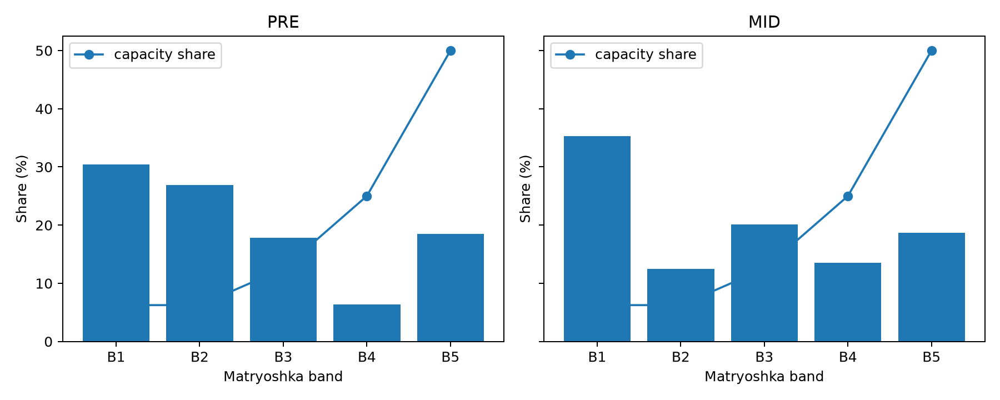
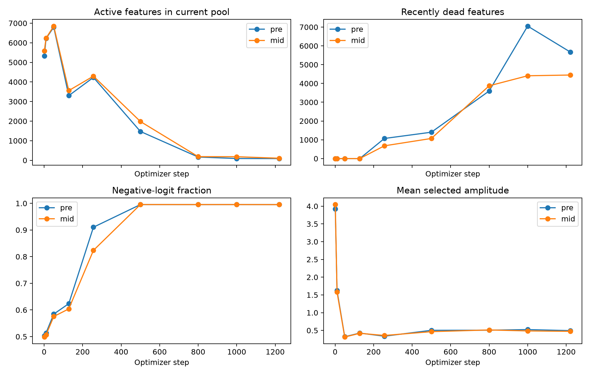

# ASPD v3 dictionary concentration and Matryoshka-bias audit

Date: 2026-11-07

Branch: `aspd-v3-decoder-norm-correction`

Evaluated training commit: `654feac6363b6f6dceb153e3b71eeed0afbbd508`

Audit implementation/artifact commit: `3d281ec36c898a3789a3871406963c75d0f42884`

## Executive decision

`MULTIPLE_CAUSES_SUPPORTED`

There is strong positional evidence consistent with a Matryoshka advantage, but
the present run does **not** establish that Matryoshka causes most of the
concentration. B1 has only 6.25% of capacity yet receives 30.46% of PRE and
35.31% of MID firing events. Per-feature B1 firing density is 13.2 times PRE
and 15.2 times MID B5 density.

Matryoshka alone cannot explain the severity. Within each fixed-opportunity
band, event-entropy effective sizes are only about 5--15 features, and the top
82 features span all five bands. Meanwhile, positive candidate scores fall
from roughly 4,000 to 39 per anchor while BatchTopK continues to select 32.
AuxK is nonzero on 85.09% of steps, but features that were dead at step 1,000
and later fired account for only 0.0165% PRE and 0.0405% MID of interval firing
events. Current AuxK also has no direct recovery gradient through a negative
ReLU logit.

The smallest justified causal follow-up is a matched 1,221-step
full-prefix-only activation-loss pilot against the existing Matryoshka arm,
with no simultaneous change to BatchTopK or AuxK. This audit does not authorize
that run.

## A. Provenance and evidence boundary

### Experiment identity

| Field | Verified value |
|---|---|
| Training job | `50138545` |
| Held-out evaluation job | `50148074` |
| Optimizer steps | 1,221 |
| Accepted training exposures | 10,002,432 |
| Held-out accepted anchors | 100,352 |
| Models | Gemma, SmolLM2, Granite |
| Training/evaluation Git SHA | `654feac6363b6f6dceb153e3b71eeed0afbbd508` |
| Config fingerprint | `04599059ec494ebe485d5e2a17780eb983a049404b2bac552f3b2c55e886dc6f` |
| Config SHA-256 | `6fbbace8188cb0267b36f8ef99f9b7b3345267f0f93b8ba6ff2077e5b0b631a4` |
| Dataset manifest SHA-256 | `a258974d21ceac3457529644be07459518fde7bc28501abde5c67e5e3719286f` |
| Alignment manifest SHA-256 | `e3fb039d2f12f3f81fef40fa064eb5b189dcfb8c99ba8fd0b6c0bccfe7a50777` |
| Checkpoint | `step-000001221` |
| Checkpoint manifest SHA-256 | `246094cafbd01b05a77762936902a70e92bd11df9b26b602c6b6ace1ef53903a` |
| Evaluation contract SHA-256 | `8a6fc9334fdacbdb16fbddf8f2675d52b6aee0e4b00a71373779b82bb67a32ef` |
| Held-out `feature_activity.csv` SHA-256 | `95405e6b75c4483d26c745ad96198c514da5868ba0077299bb75b57599038f35` |

The checkpoint-manifest digest was recomputed and exactly matches the digest
recorded by held-out evaluation. Gate count, accepted-anchor and inactivity
buffers were selectively loaded from ranks 0, 1 and 2 at both available
checkpoints and were bitwise identical across ranks.

The evaluator records `per_anchor_l2` target normalization. The matched config
sets activation-decoder normalization to `none`, and the evaluated decoder norm
distributions are non-unit and non-degenerate (means 0.290--0.315, overall
range approximately 0.096--0.708). This verifies that the corrected checkpoint,
not the historical unit-norm checkpoint, was evaluated.

The source run/evaluation artifacts record both jobs as complete and internally
consistent. A fresh live `sacct` query was unavailable during this audit because
the sandbox could not connect to SlurmDBD; no scheduler state is inferred from
that failed query. No GPU job was submitted, modified or cancelled.

### Available evidence

- Held-out reconstruction, dictionary-health and per-feature activity artifacts
  are complete for step 1,221.
- Training metrics have one canonical final row for every step 1--1,221.
- Only step-1,000 and step-1,221 checkpoints exist. Earlier requested
  checkpoints were not fabricated.
- Therefore, exact feature-count entropy/band trajectory before step 1,000 is
  `UNAVAILABLE`. Earlier trajectory statements use instantaneous pool
  diagnostics, not cumulative feature counts.
- Source remote status could not be refreshed because GitHub DNS was unavailable.
  The local branch has no configured upstream and must not be represented as
  pushed.

Machine-readable evidence is under
[`analysis/aspd_v3_dictionary_concentration_50148074`](analysis/aspd_v3_dictionary_concentration_50148074/).

## B. Matryoshka band findings

### Held-out firing distribution

Each site has 3,211,264 positive held-out firing events, equal to 32 events for
each of 100,352 anchors. Shared-gate counts were verified equal across the three
model rows before aggregation.

| Site | Band | Capacity share | Prefix opportunities | Firing events | Event share | Events/feature | Density vs uniform | Active features | Within-band effective size |
|---|---|---:|---:|---:|---:|---:|---:|---:|---:|
| PRE | B1 | 6.25% | 5 | 978,131 | 30.46% | 1,910.4 | 4.87x | 47 | 10.98 |
| PRE | B2 | 6.25% | 4 | 863,420 | 26.89% | 1,686.4 | 4.30x | 57 | 11.36 |
| PRE | B3 | 12.50% | 3 | 572,646 | 17.83% | 559.2 | 1.43x | 104 | 8.51 |
| PRE | B4 | 25.00% | 2 | 204,357 | 6.36% | 99.8 | 0.25x | 223 | 5.41 |
| PRE | B5 | 50.00% | 1 | 592,710 | 18.46% | 144.7 | 0.37x | 552 | 13.23 |
| MID | B1 | 6.25% | 5 | 1,133,850 | 35.31% | 2,214.6 | 5.65x | 70 | 13.93 |
| MID | B2 | 6.25% | 4 | 401,255 | 12.50% | 783.7 | 2.00x | 59 | 5.87 |
| MID | B3 | 12.50% | 3 | 644,583 | 20.07% | 629.5 | 1.61x | 142 | 9.02 |
| MID | B4 | 25.00% | 2 | 432,960 | 13.48% | 211.4 | 0.54x | 288 | 8.01 |
| MID | B5 | 50.00% | 1 | 598,616 | 18.64% | 146.1 | 0.37x | 705 | 14.63 |

The B1/B5 per-feature density ratio is 13.20 for PRE and 15.15 for MID. This is
strong evidence of positional association with the unequal prefix opportunity.
It is not a causal estimate because feature index and accumulated training
history were not randomized.

The within-band effective sizes are the critical counter-evidence to a
Matryoshka-only account. Even features with identical prefix opportunity show
severe winner-take-most concentration.

### Top features

| Site | Top 10 share | Top 25 share | Top 50 share | Top 82 share |
|---|---:|---:|---:|---:|
| PRE | 28.28% | 64.24% | 99.52% | 99.944% |
| MID | 27.79% | 62.46% | 98.79% | 99.902% |

| Site | B1 in top 82 | B2 | B3 | B4 | B5 |
|---|---:|---:|---:|---:|---:|
| PRE | 12 | 12 | 10 | 10 | 38 |
| MID | 17 | 10 | 12 | 15 | 28 |

The nine most frequent features are in B1 for both sites; rank 10 is in B2.
However, the complete top 82 spans all bands. B5 contributes many top-82 IDs
partly because it contains half the dictionary, but they carry much less mass
than the earliest leaders.

The required per-feature ID, band, firing count, firing probability, event
share, mean/RMS/max positive gate amplitude and observational contribution
proxy for all 164 PRE/MID rows are in
[`top_82_features.csv`](analysis/aspd_v3_dictionary_concentration_50148074/top_82_features.csv).

### Contribution by band

The available matrix contribution measure supports an observational energy
proxy:

\[
E_c=\text{matrix events}_c\times
\operatorname{RMS}(\lVert P_c x\rVert_2)^2.
\]

Aggregated over models, its band shares are:

| Site | B1 | B2 | B3 | B4 | B5 |
|---|---:|---:|---:|---:|---:|
| PRE | 69.67% | 17.52% | 7.65% | 1.45% | 3.72% |
| MID | 53.67% | 14.56% | 13.10% | 9.30% | 9.37% |

Thus early-band dominance is stronger in internal contribution energy than in
firing counts. This proxy is not a marginal residual reduction and does not
establish causal utility.

### Historical descriptive reference

| Site | Run | B1 | B2 | B3 | B4 | B5 |
|---|---|---:|---:|---:|---:|---:|
| PRE | Retired 500M Qwen/Gemma/SmolLM2 | 54.00% | 14.07% | 12.22% | 11.97% | 7.73% |
| PRE | Current 10M Gemma/SmolLM2/Granite | 30.46% | 26.89% | 17.83% | 6.36% | 18.46% |
| MID | Retired 500M Qwen/Gemma/SmolLM2 | 53.20% | 15.69% | 13.38% | 10.49% | 7.24% |
| MID | Current 10M Gemma/SmolLM2/Granite | 35.31% | 12.50% | 20.07% | 13.48% | 18.64% |

The retired 500M run was more B1-front-loaded, yet its reported effective sizes
(about 691 PRE and 671 MID) were far larger than the present 47--50. The runs
differ in model roster, raw versus normalized targets, decoder constraint,
training horizon and deleted runtime artifacts. These numbers are descriptive,
not a controlled comparison, and no Qwen artifact was loaded.

## C. Concentration trajectory

### Instantaneous pool diagnostics

These are the mean diagnostics over the four pools of the named optimizer
step. They are not cumulative dictionary counts.

| Step | PRE active/current pool | MID active/current pool | PRE dead | MID dead | PRE negative logits | MID negative logits | AuxK |
|---:|---:|---:|---:|---:|---:|---:|---:|
| 1 | 5,331 | 5,579 | 0 | 0 | 50.37% | 49.84% | 0 |
| 10 | 6,220 | 6,237 | 0 | 0 | 51.39% | 50.67% | 0 |
| 50 | 6,799 | 6,852 | 0 | 0 | 58.45% | 57.55% | 0 |
| 128 | 3,301 | 3,559 | 0 | 0 | 62.37% | 60.40% | 0 |
| 256 | 4,232 | 4,296 | 1,070 | 679 | 91.04% | 82.35% | 0.992 |
| 500 | 1,473 | 1,981 | 1,404 | 1,071 | 99.53% | 99.54% | 0.579 |
| 800 | 167 | 187 | 3,597 | 3,874 | 99.52% | 99.54% | 0.713 |
| 1,000 | 93 | 183 | 7,053 | 4,409 | 99.53% | 99.54% | 0.715 |
| 1,221 | 89 | 106 | 5,675 | 4,448 | 99.52% | 99.52% | 0.701 |

Positive main firing remains 32 per anchor except MID at step 500 (31.70).
The number of positive candidates per anchor declines from roughly 4,000 to
39. The decline in current-pool feature diversity is already visible between
steps 50 and 128, before AuxK first becomes nonzero at step 137. This timing
supports competitive concentration and shows that AuxK did not initiate it.

P95/P99 selected gate amplitudes were not logged. The evaluator recorded mean,
RMS and maximum amplitude by feature; training logged mean selected amplitude
and sampled score q90/q99. The unavailable quantities remain explicitly marked
in the machine-readable trajectory.

### Checkpoint-exact cumulative and interval counts

| Site | Measurement | Active IDs | Effective size | Top 1% share | Top 10% share | Gini |
|---|---|---:|---:|---:|---:|---:|
| PRE | Cumulative through 1,000 | 8,192 | 384.65 | 67.93% | 79.93% | 0.8618 |
| PRE | Cumulative through 1,221 | 8,192 | 281.43 | 73.73% | 83.56% | 0.8858 |
| PRE | Interval 1,001--1,221 | 2,977 | 47.13 | 99.936% | 99.984% | 0.9950 |
| MID | Cumulative through 1,000 | 8,192 | 464.12 | 64.36% | 77.54% | 0.8433 |
| MID | Cumulative through 1,221 | 8,192 | 335.98 | 70.72% | 81.57% | 0.8704 |
| MID | Interval 1,001--1,221 | 5,469 | 49.40 | 99.821% | 99.896% | 0.9943 |

Every feature fired sometime in the cumulative history, but that fact hides the
late winner-take-most regime. The exact final interval reproduces the held-out
effective size and top-share pathology. Because there is no earlier checkpoint,
we cannot compute the exact step at which entropy collapsed or an interval
entropy for 1--1,000.

## D. AuxK effectiveness

### Current semantics

The readout applies ReLU before returning scores. Those post-ReLU scores are
passed to AuxK, which restricts them to dead features and takes up to 2,048 per
anchor. A feature is declared dead after 320 consecutive pools without a
positive main firing, and any positive firing resets its inactivity counter.

Consequently:

\[
u_c<0\Rightarrow \operatorname{ReLU}(u_c)=0
\Rightarrow \nabla_{u_c}L_{\mathrm{AuxK}}=0.
\]

In addition, the implementation explicitly returns zero loss when the entire
auxiliary reconstruction is zero. AuxK can promote a dead feature whose score
is still positive but below the main BatchTopK winners; it cannot directly move
an already-negative readout logit through zero.

CPU tests verify both paths:

- all dead logits negative, nonzero residual and valid decoder: AuxK loss 0,
  raw-logit gradient 0;
- a positive dead score below a main competitor receives finite gradient and
  reenters main BatchTopK after repeated diagnostic updates;
- negative logits in the mixed case remain unchanged.

These tests characterize production behavior; they do not alter AuxK.

### Run evidence

- AuxK is nonzero on 1,039/1,221 steps (85.09%), first at step 137 and last at
  step 1,221.
- At endpoints with more than 2,048 dead features, 2,048 dead positions are
  selected per anchor by the algorithm. The logs do not record how many have
  positive post-ReLU scores.
- Between checkpoints 1,000 and 1,221, 1,854 PRE and 1,948 MID features that
  were dead at step 1,000 fire at least once. This proves reentry, not that AuxK
  caused it.
- Of these, 1,458 PRE and 1,127 MID are not dead at the endpoint; 396 PRE and
  821 MID fire and become dead again.
- All reentered features together contribute only 0.0165% PRE and 0.0405% MID
  of interval firing events. Only 386 PRE and 290 MID reentered features fire
  on held-out data, contributing 0.0231% and 0.0399% of held-out events.

Therefore AuxK is not totally inert, but it is insufficient to restore useful
dictionary diversity in this run.

### Missing instrumentation

The current artifacts do not identify per-anchor AuxK selections, positive
selected scores, per-feature AuxK gradients, AuxK-attributable logit changes,
exact dead-to-active-to-dead duration, or repeated selection dominance. A
future pilot should log those identities and transitions at bounded diagnostic
steps. Nonzero AuxK loss must not be used as a proxy for successful revival.

## E. Firing concentration versus useful mechanism contribution

The top 82 firing features also dominate the available observational internal
contribution proxy. Across models, top-feature per-event contribution RMS is
roughly 3--7 times that of the 82 rarest active features, depending on model and
site. This shows that the frequent features are not merely zero-amplitude
bookkeeping events.

However, exact activation marginal ablations

\[
\Delta_c=\operatorname{FVU}(z,\hat z^{(-c)})-
\operatorname{FVU}(z,\hat z)
\]

cannot be reconstructed from the retained aggregate CSV because per-anchor
targets, predictions, gate values and feature cross-terms are absent. The
current reconstruction FVU of approximately 0.67--0.72 also leaves substantial
unexplained variance. Therefore genuine low-dimensional sufficiency is not
established, and frequent features are not called universal mechanisms.

A bounded future read-only evaluation could compute exact \(\Delta_c\) for the
top 82 and matched rare features on a fixed held-out document subset, using the
unchanged step-1,221 checkpoint. That would require separate GPU authorization;
none was used here.

## F. Mechanism diagnosis and recommendation

| Hypothesis | Classification | Evidence | Remaining uncertainty |
|---|---|---|---|
| H1: Matryoshka positional advantage | `SUPPORTED` | B1 density is 13--15x B5; early bands dominate contribution energy | No randomized prefix membership or full-prefix-only control; causal share unknown |
| H2: BatchTopK competitive concentration | `SUPPORTED` | Positive candidates collapse toward K; current-pool active IDs fall below 100; within-band concentration remains extreme | No matched alternative sparsity treatment |
| H3: AuxK revival insufficiency | `SUPPORTED` | Nonzero on 85% of steps but recovered IDs carry less than 0.05% of events; negative ReLU logits have no direct AuxK gradient | Feature-level AuxK attribution was not logged |
| H4: Genuine low-dimensional dominance | `INCONCLUSIVE` | Frequent features dominate observed contribution energy | FVU remains 0.67--0.72; no marginal ablation or interpretability evidence |
| H5: Combination of mechanisms | `SUPPORTED` | Independent positional, competitive and revival-limit observations coexist | Interaction magnitudes require controlled ablations |

Direct answers:

1. **Does Matryoshka cause most concentration?** There is strong positional
   evidence, but no controlled evidence that it causes most of the effect.
2. **Is AuxK sufficiently reviving useful features?** No. Some features reenter,
   but their event mass and held-out generalization are negligible.
3. **Is BatchTopK competition a likely contributor?** Yes. The trajectory and
   severe within-band concentration strongly support it.
4. **Is a full-prefix-only pilot justified?** Yes, as a causal isolation of H1,
   not as a correctness fix or presumed solution.
5. **Minimum next experiment:** one matched 1,221-step full-prefix-only arm
   compared with the existing corrected Matryoshka arm, preserving model roster,
   initialization, ordered anchors, K, C, optimizer, decoder freedom, target
   normalization, AuxK and internal objective.

The future variant is:

\[
L_{\mathrm{act}}=\operatorname{FVU}(z,\hat z^{(8192)}),
\qquad
L_{\mathrm{total}}=L_{\mathrm{internal}}+L_{\mathrm{act}}+
\frac{1}{32}L_{\mathrm{AuxK}}.
\]

Pre-register checkpoints and feature-level diagnostics at steps 50, 128, 256,
500, 800, 1,000 and 1,221. Primary comparison metrics should be held-out and
final-interval effective size, top-1% share, active features, full-prefix and
oracle-original FVU, internal FVU and feature-level AuxK revival. Do not change
BatchTopK or AuxK in the same pilot.

## G. Git and test status

### Files added by the audit implementation commit

- `aspd/multimodel/v3/dictionary_concentration.py`
- `aspd/multimodel/cli/audit_aspd_v3_dictionary_concentration.py`
- `tests/test_multimodel_v3_dictionary_concentration.py`
- 13 machine-readable/plot artifacts under the analysis directory

The report itself is added in a separate documentation commit so that it can
reference the immutable analysis commit without a self-referential hash. The
final report commit is recorded in the handoff.

### Executed checks

| Check | Result | Notes |
|---|---|---|
| Dictionary/AuxK + existing feature-band + normalized-target tests | PASS, 35 tests | CPU only; 20.36 s |
| Ruff on three new Python files | PASS | `--no-cache`; cache redirected to `/tmp` |
| Compileall on three new Python files | PASS | bytecode cache redirected to `/tmp` |
| Audit CLI on production artifacts | PASS | rank-replica/checkpoint-provenance assertions passed |
| `git diff --check` before analysis commit | PASS | no whitespace errors |

The pytest cache and default Ruff cache could not be written in this sibling
worktree under the managed sandbox. The tests themselves passed; rerunning with
cache disabled or redirected resolved the tooling-only issue. No production
architecture, training objective, checkpoint or historical artifact was
modified.

## Final status

`MULTIPLE_CAUSES_SUPPORTED`
